# Generating questions with AI

*Quizzes Tutor · Teacher's guide*

> `aqg-service` is the service that writes the draft questions and the suggested replies to student doubts. This guide shows how a teacher uses it from the Tutor. To start the service, see the README at the root of the repository.

The AI reads the course documents and writes **drafts** of multiple-choice questions. **Nothing reaches the students without approval.** This guide covers the whole procedure in the interface in 5 steps, plus how to ask for a draft reply to a student's doubt.

### The path in short

1.  **Upload** a document (PDF, PowerPoint, Word or Markdown).

2.  **Put each part of it under the topics** you want (once per document). Nothing is put under a topic, or created, until you decide it.

3.  **Ask** for questions: choose one or several topics, the number of questions and the difficulty.

4.  **Wait**: the drafts are written in the background, which takes a few minutes.

5.  **Review** them in *Submissions*: approve, reject or ask for changes.

The features are under **Management › Generate** (steps 1 to 4) and **Management › Submissions** (step 5).

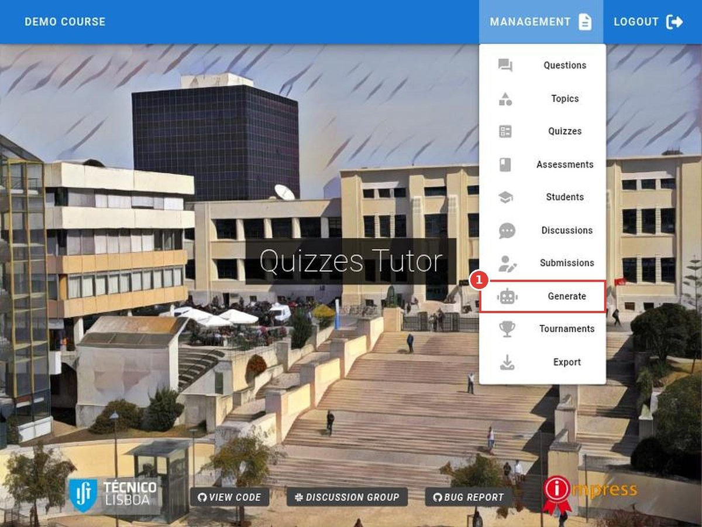

1. Open the **Management** menu and select **Generate**.

## 1. Upload the document

In **Management › Generate**, select **Upload material** and choose the file (PDF, PowerPoint, Word or Markdown, up to 100 MB). The system reads the text and splits it into pieces. A long document can take a few minutes.

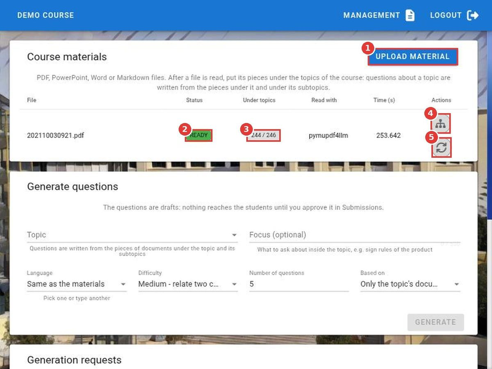

1. **Upload material**: pick the file to upload from your computer.
2. **Status**: PROCESSING while the file is read, READY when done and FAILED on error (hover the status to see why).
3. **Under topics**: how many pieces are already under a topic (in the example, 244 of 246). A new document starts with **0**: every piece is under *no topic* until you decide.
4. **Topics button** (tree icon): opens step 2.
5. **Read again**: reads the document again. This removes the topics its pieces were under, so you have to distribute them again.
6. **Delete** (bin icon): deletes the document, its pieces and the stored file, after asking for confirmation. Its pieces leave their topics. The questions already written from it are kept. A document that is still being read cannot be deleted until it finishes.

> [!TIP]
> **Tip**
>
> PDFs with selectable text (not scanned) and with a table of contents give better questions.
>
> Scanned PDFs (pages that are only images) **are not supported**: the service does no OCR, and the document ends as `FAILED` saying it has no text to read.

## 2. Put each part of the document under its topics

The AI writes questions about **the topics you pick**, using only the pieces of documents under those topics (and their subtopics). After uploading, decide where each part goes: select the topics button (item 4 above) to open the window.

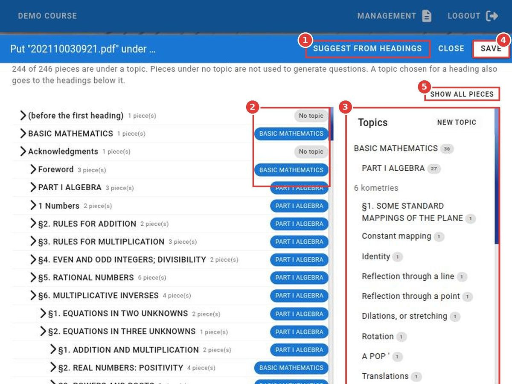

1. **Suggest from headings**: proposes topics from the headings of the document. It is only a suggestion (see below); nothing is created yet.
2. **Topics of each heading**: shown as one chip per topic on the right. *No topic* (grey) means the heading is not under any topic. Click to change.
3. **Topics**: the topics of the course and how many pieces each has. *New topic* lets you create one.
4. **Save**: saves the distribution.
5. **Show all pieces**: shows the text of each piece, so you can check it or give a single piece its own topics.

### Seeing how the document will be split

The buttons **Outline**, **Document** and **By topic** above the list change how the document is shown. Nothing is saved by switching between them, and they follow every change you make before pressing **Save**.

- **Outline**: the headings with their topics, as described above.
- **Document**: the whole text in reading order. A coloured bar beside each piece shows the topics it is under, one bar per topic. Pieces under no topic are faded, because they will not be used for questions. Click a piece to change its topics.
- **By topic**: for each topic, how many pieces and how many characters of text questions about it will be written from (its subtopics included). Open a topic to read exactly that text. A topic with less than 200 characters is flagged as having too little text, and a topic with nothing under it says so. At the end it shows what is left under no topic.

### Colours: is the topic new or does it already exist?

A legend above the list explains the colours:

- **Blue**: a topic the course already has.
- **Orange**, with *(new)* in its name: a topic that does **not** exist yet. It is only created when you press **Save**.

If you do not want a suggested topic, remove it or choose another one before saving. Nothing is created before that.

### A quick start: let the system suggest

Select **Suggest from headings** and choose how many levels of headings should become topics. Pick the level that fits the structure you want and adjust afterwards. The suggested topics that the course already has are shown in blue, and the others in orange (new).

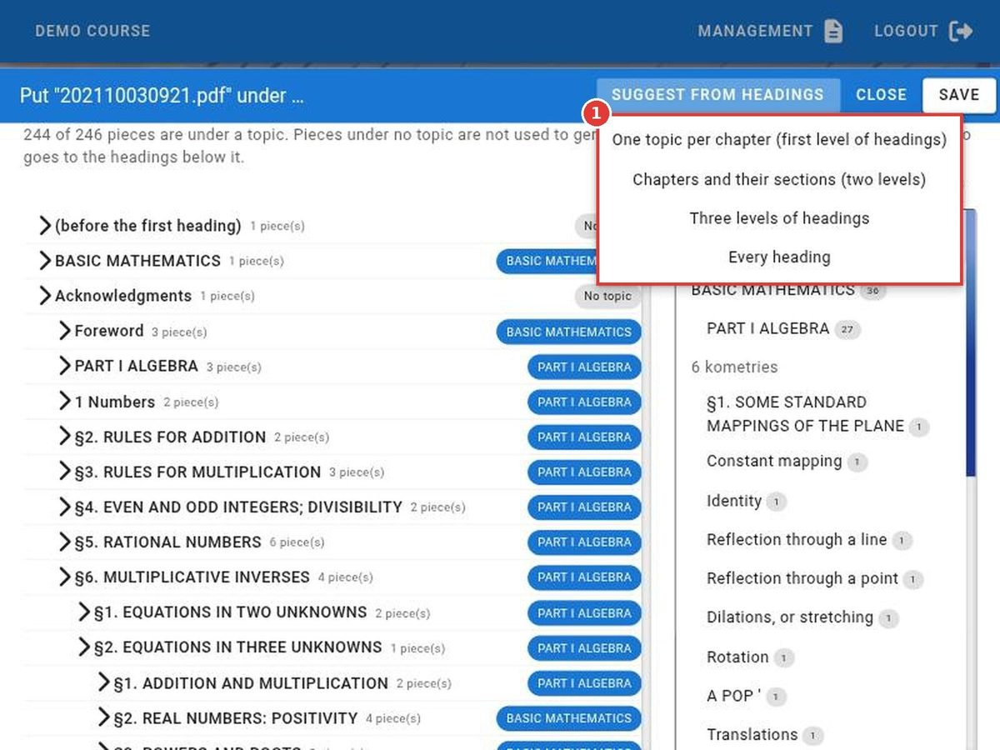

1. Options: *One topic per chapter* (main chapters only), *Chapters and their sections* (two levels), *Three levels of headings* and *Every heading* (all headings become topics).

### Changing the topics of a part

Click the chips of the heading and pick **one or several** topics, or create a new one. A piece of a document can be under as many topics as you want.

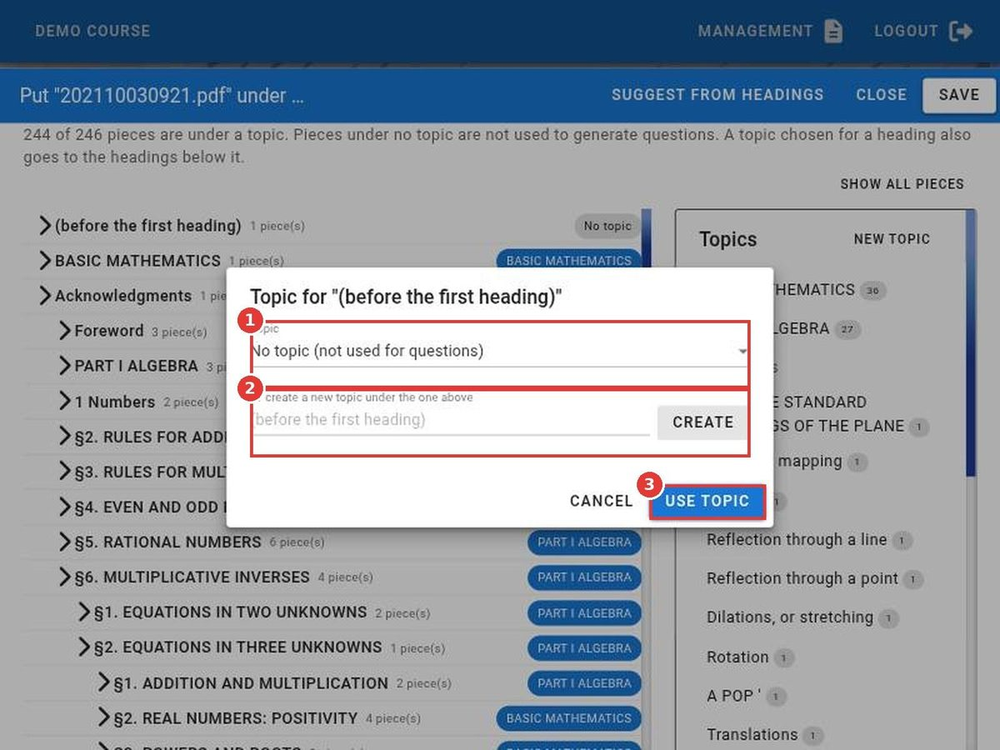

1. **Topics**: choose any number of topics from the list. Leave it empty to put the part under *no topic*.
2. **Creating a new topic**: type its name and press *Create*. If exactly one topic is chosen, the new topic goes under it and replaces it in the choice; otherwise it goes at the top level and is added to the chosen topics.
3. **Use topics**: applies the choice.

- The topics given to a heading also apply to the headings below it.

- If the pieces of a heading are under different topics, it says *Several topics*. Whatever you choose then replaces the topics of all its pieces.

- Pieces under *no topic* **are left out** of question generation.

- Putting a piece under a topic does not take it away from its other topics.

- The distribution is saved for future use of the document.

## 3. Ask for the questions

On the same page there is the **Generate questions** form. First pick the topics you want, **one or several**; the list shows how many pieces each has.

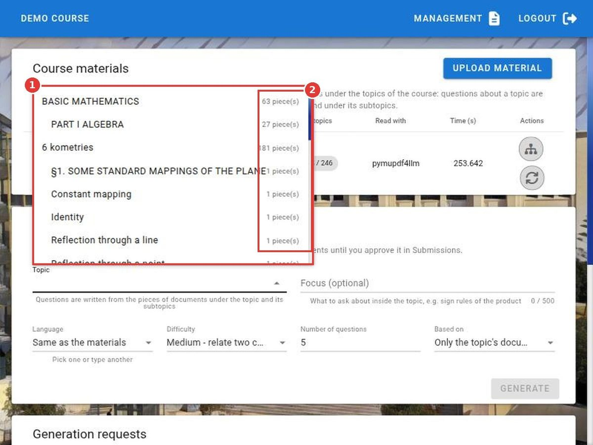

1. **Topics of the course**, in a tree with their subtopics.
2. **Number of pieces** of each topic (subtopics included). Topics with no pieces cannot be used for generation.

After filling in the options, select **Generate**.

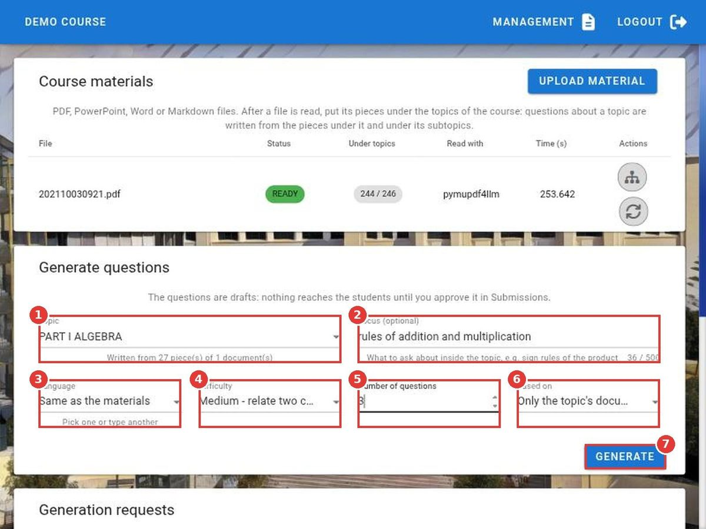

1. **Topics**: pick up to 10 topics. The pieces of all of them are used, and a piece that is under several of them counts once. The hint shows how many pieces of how many documents will be read (in the example, 27 pieces of 1 document).
2. **Focus** (optional): narrows the scope inside the topics (e.g. *rules of addition and multiplication*). At most 500 characters.
3. **Language**: *Same as the materials* or another language.
4. **Difficulty**: *Easy* (recalling facts or definitions), *Medium* (relating concepts) or *Hard* (applying them to new situations).
5. **Number of questions**: between 1 and 10 per request.
6. **Based on**: *Only the topic's documents* (answers strictly from the documents) or *Documents plus general knowledge* (adds general knowledge while staying grounded in the material).
7. **Generate**: sends the request.

Every generated question is filed under **all** the topics you picked.

> [!TIP]
> **For sharper questions**
>
> Narrow, specific topics give more precise questions than broad ones. Use **Focus** to refine the request. If you are told there is not enough material, put more pieces under the topics.

## 4. Wait

The **Generation requests** section shows the state of the request. While the questions are written it says GENERATING. You can keep using the system meanwhile.

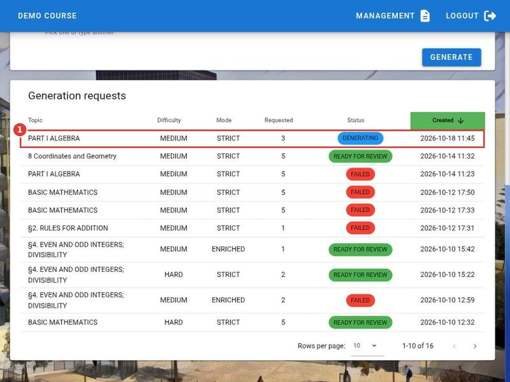

1. A request being processed.

When it finishes, the state becomes READY FOR REVIEW: the questions are ready to be checked.

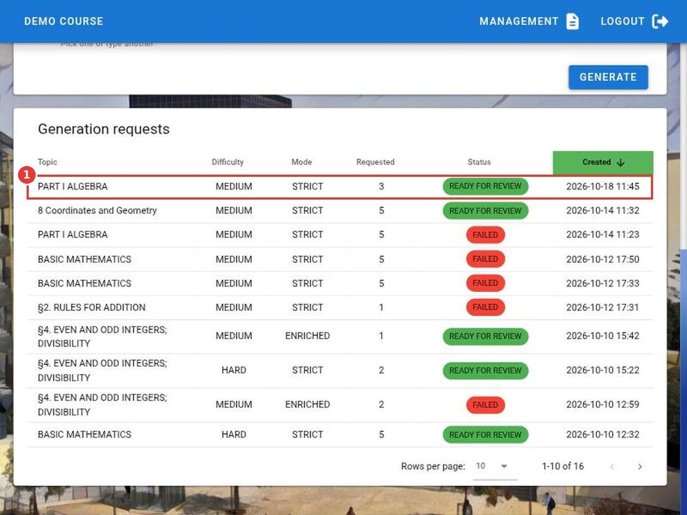

1. READY FOR REVIEW: the questions are in *Submissions*.

If it says FAILED, hover it to see the reason (e.g. the model is unavailable); you can then ask again.

## 5. Review and approve

Go to **Management › Submissions**. The questions written by the AI have the prefix AI-… and show the model that wrote them. **The difficulty you asked for is kept in the name of the question, in brackets at the end** (for example *What does 404 mean? (Medium)*), so you can tell it in the list.

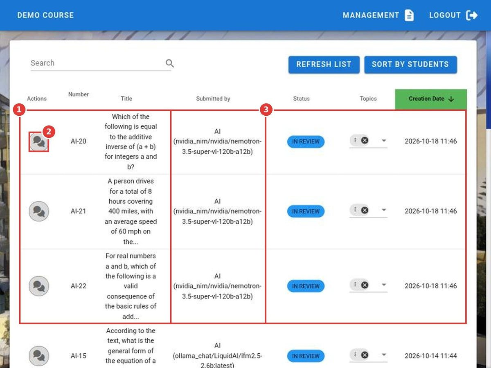

1. **Generated questions**: AI-20, AI-21 and AI-22 are the ones requested in this example.
2. Opens the question.
3. **Author**: the AI model that was used.

### Looking at a question in detail

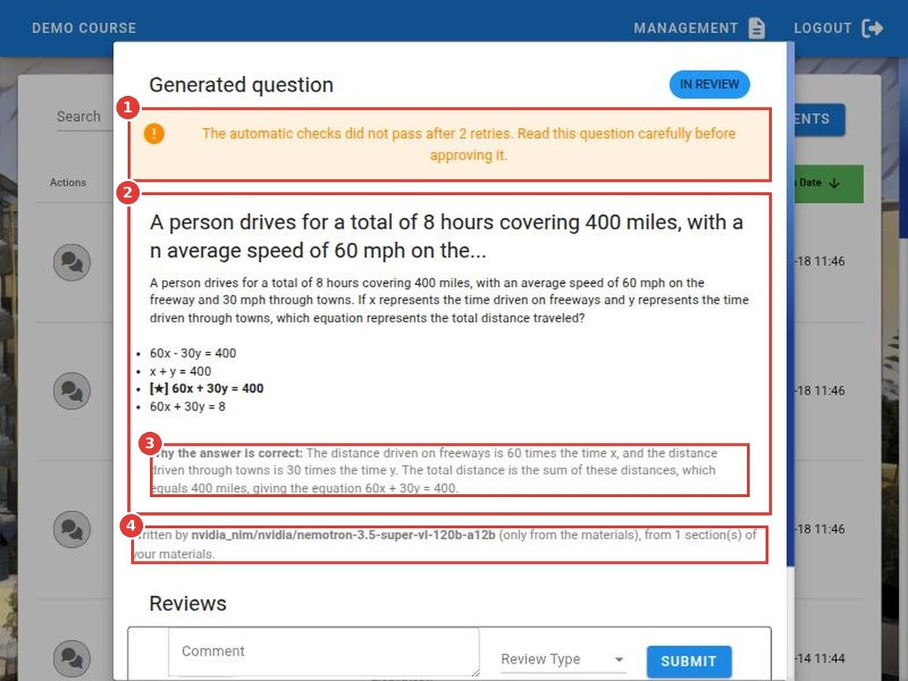

1. **Check warning** (only when it applies): the AI tried to correct the question, but the automatic checks still find problems. **Check the content carefully** before approving.
2. **The question and its options.** The correct option is marked with \[★\].
3. **Why the answer is correct**: the justification written by the system.
4. **Written by**: the model, how many pieces of the source were read and the difficulty that was asked for.

> [!WARNING]
> **Technical review is required**
>
> The automatic checks catch formatting and grounding problems, but they **do not guarantee** pedagogical quality or technical accuracy. The final decision to approve is entirely the teacher's.

### Deciding

In the **Reviews** section of the same window, choose the action and select *Submit*.

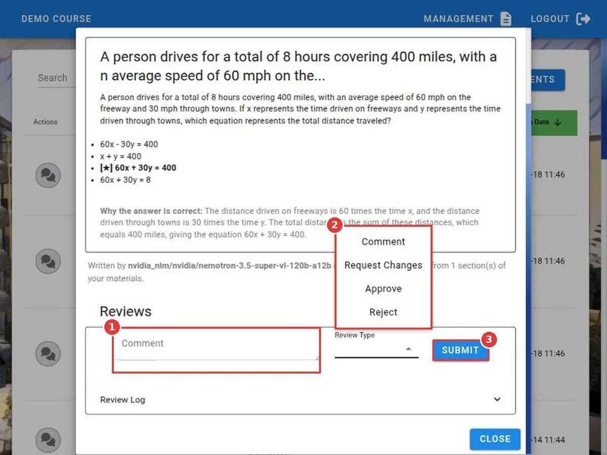

1. **Comment**: a field for your remarks.
2. **Review Type**: the decision to apply (see the table below).
3. **Submit**: sends the review.

| **Choice** | **What happens** |
|----|----|
| **Approve** | The question is approved and added to the database, ready for quizzes and tournaments. |
| **Reject** | The question is rejected. A comment is optional. |
| **Request Changes** | The AI **rewrites the question** following your comment (required). |
| **Comment** | Only records the remark; the question stays pending. |

### Asking the AI to rewrite

To adjust a question, choose **Request Changes** and describe what to change. The submit button then reads *Regenerate with review*.

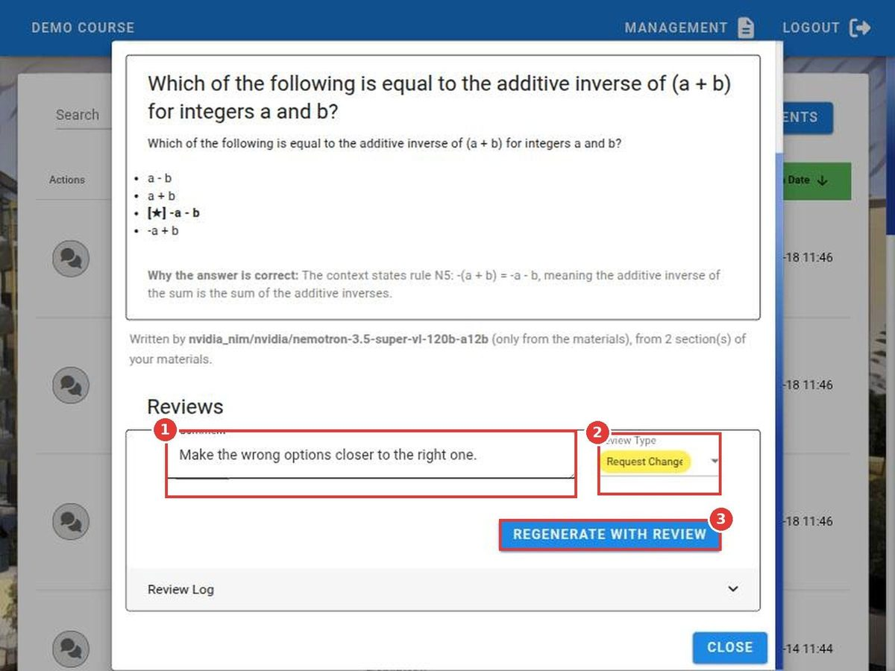

1. **Instructions for the change** (e.g. *Make the wrong options closer to the right one*).
2. **Request Changes** (the yellow label).
3. **Regenerate with review**: the AI rewrites the question, using the pieces under all the topics of the request. The list of submissions updates by itself when the new version is ready.

## Replying to student doubts with AI

In the discussions, the AI can write a **draft** reply for the teacher to check, edit and send: **nothing is sent automatically.**

### 1. Open the discussion

The messages sent by students are listed in **Management › Discussions**.

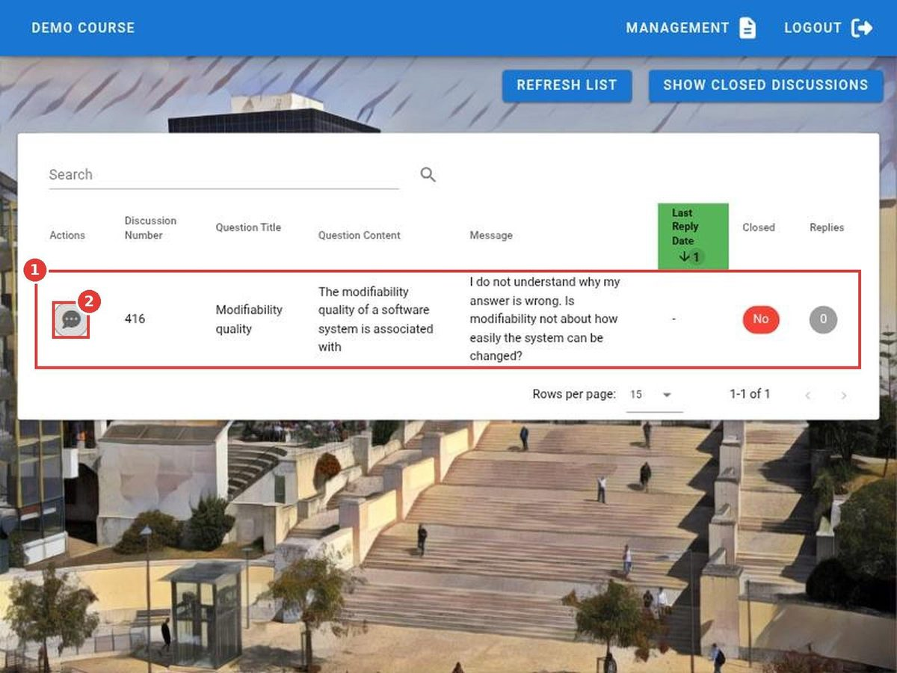

1. **The student's doubt**, with the question it refers to.
2. Opens the discussion.

### 2. Write the draft

The page shows the original question, the student's doubt and the reply box. Select **Suggest reply** to start.

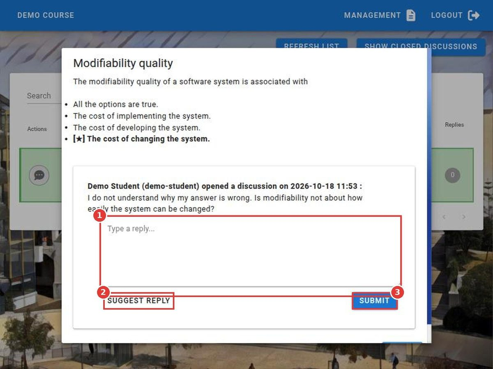

1. **The reply box.**
2. **Suggest reply**: asks for a draft reply (it takes a few seconds).
3. **Submit**: sends the final reply to the student.

### 3. Check, edit and submit

The draft is placed in the reply box. After making your edits, select **Submit**.

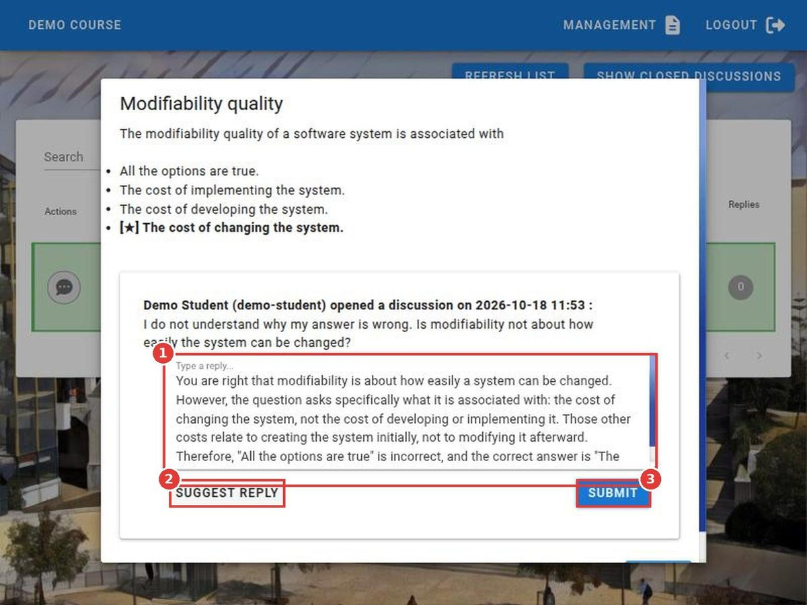

1. **The draft**: you can edit it directly in the text box.
2. **Ask again** (*Suggest reply*): writes another proposal. If the box already has text, you are asked to confirm before it is replaced.
3. **Submit**: sends the checked version to the student.

- The draft is based on the question, the option the student chose, the text of the doubt and the documents under the topic.

- **No personal data or identifier of the student** is sent to the AI model.

- If the topic has no documents, the draft is written only from the question and the doubt.

> [!WARNING]
> **Check the draft**
>
> The AI can write replies that are inaccurate or generic. Check the information and adjust the tone before sending.

## For administrators

Under **Administration**, two pages are for the system administrator:

- **Question Generation Model**: which models write the questions, the fallbacks and the timeout. When **Save** is off, the reason is written beside it (for example a provider with no API key in the service's `.env`, or an empty model name).
- **Question Generation Usage**: a table of the requests each course made on each of the last 7, 10 or 30 days, with the number of questions they asked for in brackets, and the totals per course and per day.

The timeout is a limit of our service only: it is how long the service waits for the model to answer one call. A call that exceeds it is repeated once and then the next fallback is tried; an answer that arrives after that is thrown away on our side and never shows up as a question.

## System messages and notifications

To protect the model's resources there are limits. The most common messages:

| **Message** | **Description** |
|----|----|
| *Wait N more second(s) before asking for more questions* | There is a minimum pause between consecutive requests (10 seconds by default). |
| *You already have N request(s) being written…* | Requests are still being processed. Wait for them to finish and check the list. |
| *The question generation queue is full* | The processing queue is full. Try again in a few minutes. |
| *This course has already requested X of its Y questions for today* | The daily limit of questions for the course was reached. It resets at 00:00 (UTC). |
| *The model is busy right now* | The model server reached its per-minute capacity. Wait a minute before trying again. |
| *Wait N more second(s) before asking for another suggested reply* | There is a minimum pause between consecutive reply drafts (5 seconds by default). |
| *the model did not answer* | The service is unavailable or slow. If the problem persists, contact the system administrator. |
| *reply suggestions are turned off* | The administrator turned the reply suggestions off. |
| *Pick at least one topic of the course to generate questions about* | No topic was chosen in the form. |
| *Pick at most 10 topics for each request* | Too many topics in one request. Split it into two. |
| *Neither these topics nor their subtopics have pieces of a document under them yet* | Put pieces of a document under the topics first (step 2). |

### Good practice

- **Check first**: always check the question and its correct option before approving.

- **File quality**: prefer PDFs with searchable text and a structured table of contents.

- **Granularity**: use specific topics and the **Focus** field to refine the generation. Use several topics when a question should draw on more than one.

- **Small batches**: ask for few questions (3 to 5 per request) and review them as you go.

- **Adjustments**: use **Request Changes** instead of rejecting questions that can be saved.

- **Reprocessing**: when you read a document again, put its pieces under the topics again.

> *The screenshots come from the demonstration course; in the interface you see the files and topics of your own course. Some screenshots of the distribution window and the form predate the colour legend and the multi-topic choice.*
